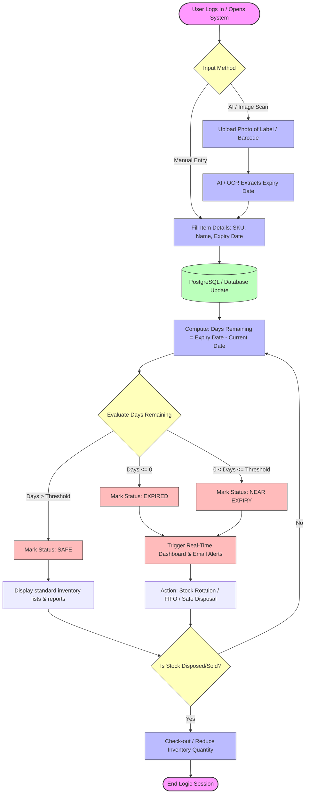

# 📦 Product Expiry Tracking System (FMCG / Retail FIFO Engine)

A production-grade, architectural implementation of an intelligent Product Expiry Tracking System with First-In, First-Out (FIFO) stock rotation built in Python 3.10+.

---

## 🏗️ Architecture Blueprint Mapping

This system strictly maps to the Mermaid architectural workflow:



---

## ⚡ Tech Stack Specifications

- **Backend Engine**: Python 3.10+ (Clean, modular, production-ready design)
- **Database Infrastructure**: PostgreSQL using `psycopg2-binary` (High-performance parameterized raw SQL queries with automatic SQLite developer fallback)
- **Artificial Intelligence**: Google Gemini API free-tier via the official `google-genai` SDK (`gemini-2.5-flash`)
- **Presentation & Dashboards**: `rich` & `tabulate` (Color-coded KPI cards, status badges, and interactive modals)
- **Data Validation**: `pydantic` v2 (Strict type checking, date normalization, and boundary enforcement)

---

## 🚀 Quick Start Guide: How to Run the Project

### 1. Prerequisites & Environment Setup

Ensure Python 3.10+ is installed on your system. Open your terminal in the project directory:

```powershell
# Navigate to the project directory
cd "d:\Expiry tracker project"

# Install required dependencies
pip install -r requirements.txt
```

---

### 2. Configure Credentials (.env)

The repository includes a ready-to-use `.env` file (and `.env.example`). Open `.env` and set your credentials:

```ini
# PostgreSQL Database Settings
DB_HOST=localhost
DB_PORT=5432
DB_NAME=postgres
DB_USER=postgres
DB_PASSWORD=your_postgres_password_here
FALLBACK_TO_SQLITE=true

# Google Gemini API (Free Tier from https://aistudio.google.com/)
GEMINI_API_KEY=your_gemini_api_key_here
GEMINI_MODEL=gemini-3.5-flash

# Lifespan Rules & Alert Configuration
EXPIRY_THRESHOLD_DAYS=30
MANAGER_ALERT_EMAIL=inventory-manager@store.internal
ALERT_SENDER_EMAIL=alerts@inventory-system.internal
```

> **Note on Developer Resilience**: If PostgreSQL or Gemini credentials are not yet configured, the system automatically falls back to the local SQLite engine (`expiry_tracker.db`) and a deterministic heuristic OCR parser. You can run and test everything out of the box with zero setup friction!

---

### 3. Running the Application

#### Option A: Modern Streamlit Web UI (Recommended)
Launch the user-friendly interactive web application in your browser:
```powershell
streamlit run app.py
```
This launches a browser-based dashboard with:
- **Real-Time Visual KPI Cards** (Expired, Near Expiry, Safe)
- **Instant Demo Seed Button** (1-click test of all 3 states)
- **Drag-and-Drop AI Label Scanner** (Gemini Vision)
- **Interactive Search & Category Filters**
- **1-Click Checkout & Hazardous Disposal Controls**
- **Live Email Broadcast Audit Logs**

---

#### Option B: Interactive CLI Mode (Terminal State Machine)
Launch the interactive terminal dashboard:
```powershell
python main.py
```
This opens the interactive menu allowing you to:
1. Perform manual item entry (`[1]`)
2. Scan packaging images or OCR labels with Gemini AI (`[2]`)
3. View real-time inventory dashboards & status checks (`[3]`)
4. Check-out, rotate, or safely dispose of stock (`[4]`)
5. Seed demo data illustrating all 3 status boundaries (`[5]`)
6. Run system diagnostics (`[6]`)

---

#### Option B: Quick Demo Seed & Dashboard (One Command)
Populate sample records (Expired, Near Expiry, Safe) and immediately visualize the real-time dashboard and email alert triggers:
```powershell
python main.py --seed
```

---

#### Option C: View Dashboard Non-Interactively
```powershell
python main.py --dashboard
```

---

#### Option D: Test AI / OCR Label Extraction
Test Gemini multimodal extraction on text streams or image files:
```powershell
# Test on sample milk receipt / OCR label:
python main.py --test-ai "sample_labels/sample_ocr_milk.txt"

# Test on sample pharmacy label:
python main.py --test-ai "sample_labels/sample_ocr_pharmacy.txt"

# Test on raw text directly:
python main.py --test-ai "LOT# 9981 FRESH YOGURT EXP: 2026-10-18 QTY: 6"
```

---

#### Option E: Run Automated Test Suite
Run the 21 unit and integration tests covering all 7 architectural nodes:
```powershell
python -m unittest test_expiry_tracker.py
```

---

## 📊 Core Workflow Breakdown

| Node # | Architecture Component | Module | Functional Description |
| :--- | :--- | :--- | :--- |
| **Node 1** | `[Start -> Mode]` | `main.py` | Event loop prompting user between Manual Entry and AI Scan. |
| **Node 2** | `[Manual Entry -> Form]` | `ui.py` | Validated CLI form capturing SKU, Name, Expiry Date, Quantity. |
| **Node 3** | `[AI / Image Scan -> Gemini]` | `gemini_extractor.py` | Calls `google-genai` to extract dates and fields from packaging. |
| **Node 4** | `[Data Persistence DB]` | `database.py` | Parameterized raw SQL UPSERT and table management in PostgreSQL. |
| **Node 5** | `[Processing Core Calc]` | `lifespan_engine.py` | Evaluates equation: `Days Remaining = Expiry - Today`. Assigns `EXPIRED` ($\le 0$), `NEAR EXPIRY` ($0 < \text{Days} \le 30$), or `SAFE` ($> 30$). |
| **Node 6** | `[Action Triggers & Dash]` | `alerts.py` & `ui.py` | Renders color-coded table, triggers urgent simulated email alerts and audit log (`alerts.log`). |
| **Node 7** | `[UpdateOut -> CheckOut -> End]` | `inventory_service.py` | Deducts sold items, executes safe disposal of expired goods, completes session. |

---

## 📁 Project File Structure

```
d:\Expiry tracker project\
│
├── .env                         # Active configuration & API credentials
├── .env.example                 # Configuration template for developers
├── requirements.txt             # Required Python dependencies
├── README.md                    # Project documentation & execution guide
│
├── config.py                    # 12-factor configuration & environment parser
├── database.py                  # PostgreSQL raw SQL persistence layer (psycopg2)
├── gemini_extractor.py          # Google GenAI (Gemini 2.5 Flash) vision & OCR extractor
├── models.py                    # Pydantic v2 schemas, status enums & domain models
├── lifespan_engine.py           # Mathematical lifespan equation & boundary evaluation
├── alerts.py                    # Real-time alert triggers & urgent email broadcast simulator
├── inventory_service.py         # Business service layer orchestrating workflows
├── ui.py                        # Rich CLI dashboard, forms, tables & status badges
├── main.py                      # Main executable application entry point
├── test_expiry_tracker.py       # 21 comprehensive unit & integration tests
│
└── sample_labels/               # Sample assets for testing AI vision/OCR branch
    ├── sample_ocr_milk.txt
    ├── sample_ocr_pharmacy.txt
    ├── artisan_cheese_label.png
    └── generate_sample_image.py
```
