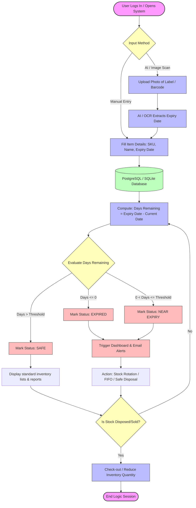

# 📦 Product Expiry Tracking System (FMCG / Retail FIFO Engine)

> **An Intelligent Retail & Pharmacy Inventory Monitoring System**  
> *Automating expiry date logging via Multimodal OCR / Gemini Vision AI, enforcing First-In, First-Out (FIFO) stock rotation, and preventing costly retail spoilage.*

[](https://github.com/akshaykaygude/Product-Expiry-Tracking-System/actions/workflows/ci.yml)
[](https://www.python.org/)
[](Dockerfile)
[](https://streamlit.io/)
[](database.py)
[](LICENSE)

---

## 🏗️ Architecture Blueprint

This system is built around a closed-loop inventory tracking architecture from packaging scanning to stock checkout:



---

## 🎯 Current Capabilities: What Already Works

The following components are fully implemented, verified, and tested in this codebase:

- [x] **AI / OCR Label Date Extraction (`gemini_extractor.py`)**:
  - Ingests product packaging images (JPG, PNG) or raw scanner text streams.
  - Employs Google Gemini 2.5 Flash via `google-genai` with a deterministic local regex/heuristic fallback for offline use.
  - Multi-date disambiguation: automatically prioritizes Expiry / Best-Before markers (`EXP`, `BB`, `USE BY`) over Manufacturing (`MFG`, `PKD`) dates.
- [x] **Mathematical Lifespan Engine (`lifespan_engine.py`)**:
  - Computes $	ext{Days Remaining} = 	ext{Expiry Date} - 	ext{Today}$.
  - Dynamically classifies stock into strict status tiers: **SAFE** ($> 30	ext{ days}$), **NEAR EXPIRY** ($0 < 	ext{Days} \le 30$), and **EXPIRED** ($\le 0	ext{ days}$).
  - Sorts active inventory using FIFO (First-In, First-Out) priority to prevent shrink and waste.
- [x] **Dual Persistence Layer (`database.py`)**:
  - Production PostgreSQL driver using parameterized SQL queries.
  - Zero-configuration local SQLite fallback (`expiry_tracker.db`) enabling immediate out-of-the-box local testing.
- [x] **Interactive Web Application (`app_streamlit.py`)**:
  - Full browser dashboard with live KPI counters, status filtering, packaging image upload scanner, manual entry, and checkout actions.
- [x] **Terminal UI & Event Runner (`main.py`, `ui.py`)**:
  - Color-coded Rich terminal tables, status badges, and interactive CLI menus.
- [x] **Alerting & Audit Logger (`alerts.py`)**:
  - Formats urgent alerts for near-expiry and expired stock with write-ahead file logging (`alerts.log`).
- [x] **Automated Testing Suite (`test_expiry_tracker.py`)**:
  - Comprehensive unit and integration test suite covering lifespan equations, DB operations, multi-date parsing, and stock checkout.
- [x] **Continuous Integration & Containerization**:
  - GitHub Actions CI running on Python 3.10 and 3.11 (`.github/workflows/ci.yml`).
  - Production-ready `Dockerfile` and `docker-compose.yml`.

---

## ⚠️ Known Limitations & Real-World Edge Cases

We believe in documenting real-world challenges transparently:

1. **Regional Date Ambiguity**:
   - In numerical formats without letters (e.g., `04/05/2026`), disambiguating between US (`MM/DD/YYYY`) and European/Indian (`DD/MM/YYYY`) conventions remains ambiguous when the day is $\le 12$. The heuristic parser currently defaults to `DD/MM/YYYY`.
2. **Curved & Foil Packaging Distortion**:
   - Extreme optical glare on plastic wraps or curved bottle bottlenecks can degrade camera-based OCR accuracy. In production, users can verify and override extracted fields before committing to the database.
3. **Multi-Lot Batch Tracking**:
   - While identical SKUs with different expiration dates are supported as distinct records, automated pallet consolidation across multi-warehouse locations is currently planned for v2.

---

## 🗺️ Development Roadmap & Next Milestones

- [x] **v1.0 (Core Engine)**: Mathematical lifespan equations, FIFO queue, and SQLite/PostgreSQL persistence.
- [x] **v1.1 (Multimodal Vision)**: Google Gemini 2.5 Flash OCR integration with offline heuristic fallback.
- [x] **v1.2 (Interactive Web UI)**: Streamlit dashboard with image upload and instant checkout workflows.
- [x] **v1.3 (DevOps & CI)**: Docker multi-stage containerization and GitHub Actions automated test pipeline.
- [ ] **v2.0 (Barcode Hardware Integration)**: Direct GS1-128 and EAN-13 barcode scanner support with global product catalog lookup.
- [ ] **v2.1 (Offline Edge OCR)**: Lightweight on-device OCR model (ONNX Runtime / Tesseract) for offline warehouse environments without cloud access.
- [ ] **v2.2 (Multi-Store ERP Sync)**: Webhook endpoints for automated synchronization with SAP and Shopify inventory.

---

## 🚀 Quick Start: How to Run the Project

### Option A: Interactive Web UI (Recommended)
Launch the Streamlit web interface in your browser:
```bash
streamlit run app_streamlit.py
```
Open **`http://localhost:8501`** to view the live dashboard, upload packaging labels, and manage inventory.

---

### Option B: Terminal CLI Mode
Run the interactive console application:
```bash
python main.py
```

---

### Option C: Docker Deployment
Run the complete stack (app + PostgreSQL) with Docker Compose:
```bash
docker compose up --build
```

---

### Option D: Run Automated Test Suite
Execute the unit and integration test suite:
```bash
python -m unittest test_expiry_tracker.py
```

---

## 📁 Repository Structure

```text
Product-Expiry-Tracking-System/
├── .github/workflows/
│   └── ci.yml                   # GitHub Actions automated CI testing workflow
├── Dockerfile                   # Container build recipe
├── docker-compose.yml           # Multi-container orchestration (App + PostgreSQL)
├── .dockerignore                # Docker build exclusions
├── .env.example                 # Configuration template for developers
├── requirements.txt             # Project dependencies
├── README.md                    # Documentation, architecture, capabilities & roadmap
├── LICENSE                      # MIT Open-Source License
│
├── app_streamlit.py             # 🌟 Interactive Streamlit web dashboard
├── main.py                      # Interactive Terminal CLI entry point
├── config.py                    # 12-factor configuration & environment parser
├── database.py                  # PostgreSQL & SQLite persistence layer
├── gemini_extractor.py          # Gemini 2.5 Flash vision & OCR extractor
├── lifespan_engine.py           # Mathematical lifespan equations & FIFO classifier
├── inventory_service.py         # Business service layer orchestrating workflows
├── alerts.py                    # Real-time alert triggers & audit log simulator
├── models.py                    # Pydantic v2 schemas and domain models
├── ui.py                        # Rich terminal formatting & status badges
├── test_expiry_tracker.py       # Comprehensive unit and integration test suite
│
└── sample_labels/               # Sample packaging test fixtures
    ├── sample_ocr_milk.txt
    ├── sample_ocr_pharmacy.txt
    ├── artisan_cheese_label.png
    └── generate_sample_image.py
```

---

## 📄 License

This project is licensed under the [MIT License](LICENSE).
